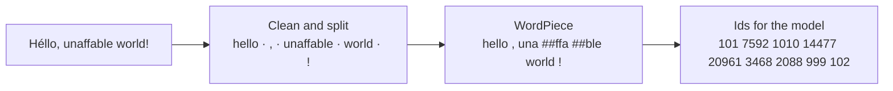
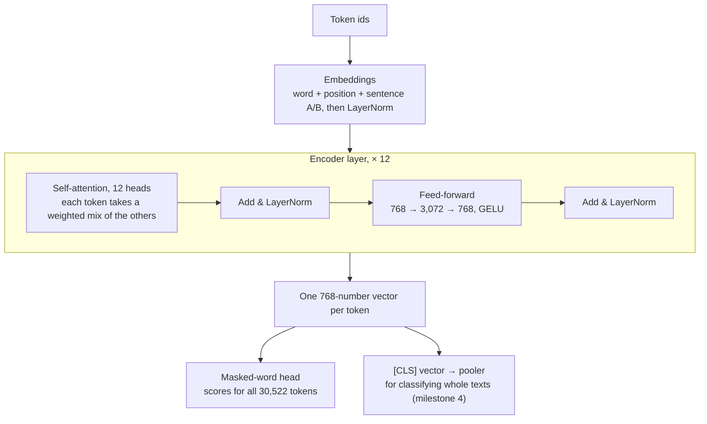
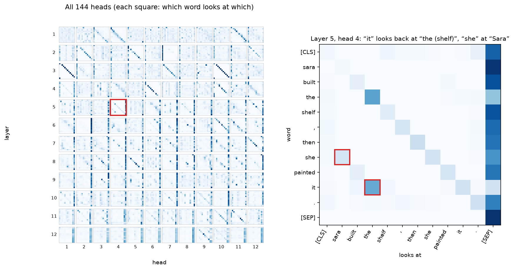

# Mini BERT

[](https://github.com/omdkpatel810-ops/mini-bert/actions/workflows/tests.yml)


[](LICENSE)

BERT, the language model behind Google Search's 2019 upgrade, built from scratch to learn how it works inside. Each part gets checked against Google's own code and weights.

> **Status: milestone 2 of 5 is done.** The tokenizer and the Transformer model are complete, and Google's pre-trained BERT runs on them. Training our own comes next ([roadmap](#roadmap)).

```text
$ minibert fill "Paris is the [MASK] of France."
  capital   99.7%
  heart      0.1%
  center     0.0%
```

**At a glance**

- **BERT's Transformer, written out by hand** in PyTorch, attention included. Google's 110-million-parameter BERT-Base loads into it. It makes the same best guess as Hugging Face's official implementation for **all 3,709 hidden words** in 256 Wikipedia sentences, and runs within 6% of its speed.
- **Exactly Google's tokenizer.** It matches Google's original code on all 511,834 tokens of WikiText-103's test and validation text, and on over 10,000 random Unicode strings in every test run. It is 2.5x faster than Google's Python.
- **Found three ways Hugging Face's Rust tokenizer differs from Google's code,** including a typo in one of its Chinese-character ranges ([details](#where-hugging-face-differs-from-google)).
- **Trained our own 30,522-token vocabulary** on 105 million words of Wikipedia in 2 min 40 s. It splits held-out text into 1.081 tokens per word, the same as Hugging Face's trainer and fewer than Google's vocabulary (1.094).
- 116 tests with 100% line coverage, many property-based (Hypothesis), on Python 3.10 and 3.13.

## Quick start

Requires Python 3.10 or newer. Without an NVIDIA GPU, install PyTorch's smaller CPU-only build first.

```bash
git clone https://github.com/omdkpatel810-ops/mini-bert.git
cd mini-bert
python3 -m venv .venv
source .venv/bin/activate        # Windows: .venv\Scripts\activate
pip install torch --index-url https://download.pytorch.org/whl/cpu
pip install -e ".[dev,data]"

minibert fill "She opened the [MASK] and took out the milk."   # downloads BERT-Base (440 MB) once
minibert tokenize "Where is Winnipeg?" --pair "Winnipeg is in Manitoba."
```

```python
import torch

from minibert.checkpoint import load

model, tokenizer = load("bert-base-uncased")  # Google's weights, in our model
batch = tokenizer.encode_batch(["Hi", "Hello there, world"])
logits, output = model(
    torch.tensor([e.ids for e in batch]),
    attention_mask=torch.tensor([e.attention_mask for e in batch]),
)
print(output.hidden.shape)  # torch.Size([2, 6, 768]): one 768-number vector per token
```

## Part 1: the tokenizer

### How BERT reads text



1. **Clean and split into words.** Drop control characters, put spaces around Chinese characters, lowercase, strip accents (*Héllo* → *hello*) and split off punctuation.
2. **WordPiece.** Each word becomes the longest pieces found in the 30,522-token vocabulary, left to right. *unaffable* isn't in the vocabulary, but *una*, *##ffa* and *##ble* are. The *##* marks a piece that continues a word. A word that can't be built from known pieces becomes `[UNK]`.
3. **Ids.** `[CLS]` starts every input, which BERT later uses to classify the whole text. `[SEP]` ends each sentence. Each token becomes its line number in the vocabulary.

Pairs of texts (a question and a passage, say) get a sentence A/B marker for every token. When a pair is too long, tokens come off the longer side first, as in Google's code. `[MASK]` typed in the text stays a special token, for fill-in-the-blank.

### Training a vocabulary

Google never published how it built BERT's vocabulary. This uses the method Hugging Face's WordPiece trainer uses:

1. **Count words.** Split the text exactly as the tokenizer will, and count each word, using every CPU core.
2. **Start with characters.** Every character gets two tokens, *a* to start a word and *##a* to continue one. Only the 1,000 most common characters get tokens; rarer ones will be `[UNK]`.
3. **Merge pairs.** Write each word as characters (*h ##u ##g*). Then repeatedly glue the most frequent neighbouring pair into a new token (*##u* + *##g* → *##ug*) until the vocabulary is full.

Recounting every pair after each of the 28,517 merges would take hours. Instead, each merge updates the counts only for the words it touches, and a heap finds the next most frequent pair.

```bash
python scripts/get_wikitext.py                    # WikiText-103 into data/
minibert train-tokenizer data/wikitext-103/train.txt --out runs/wikitext-vocab.txt
```

On WikiText-103's held-out test text (249,712 words), from `scripts/compare_vocabs.py`:

| Vocabulary | Trained on | Time | Tokens per word | Words split | `[UNK]` |
| --- | --- | ---: | ---: | ---: | ---: |
| Ours | WikiText-103 | 160 s (Python) | **1.081** | 5.6% | 0.009% |
| Hugging Face's trainer | WikiText-103 | 85 s (Rust) | **1.081** | 5.6% | 0.008% |
| Google's bert-base-uncased | Wikipedia and books | — | 1.094 | 5.7% | 0.012% |

Our trainer and Hugging Face's share 29,988 of their 30,522 tokens; the rest differ on how ties are broken. A vocabulary trained on the text it will read splits fewer words, which is why both beat Google's general-purpose one here.

### Checking the tokenizer

Google's original `tokenization.py` sits in `tests/reference/`. Its only change is replacing two TensorFlow imports, so it runs without TensorFlow. It's the referee:

- `scripts/compare_tokenizers.py` runs Google's code, ours and Hugging Face's over WikiText-103's test and validation text. All 5,352 lines come out identical. Google's takes 2.3 s, ours 0.9 s, Hugging Face's (Rust) 1.1 s.
- Property tests feed thousands of random Unicode strings (emoji, accents, control characters, every script) to ours and to Google's, cased and uncased, and require identical output.

Ours is faster than Google's because each rule is one regular expression over a character class built once from Unicode's tables. Google's code checks every character's category in a Python loop.

### Where Hugging Face differs from Google

The property tests found three differences, which ours does not share:

| Input | Google and ours | Hugging Face | Why |
| --- | --- | --- | --- |
| `a𫠠b` (U+2B820) | `a [UNK] b` | `[UNK]` | A typo in one Chinese-character range: Hugging Face starts it at U+2B920, Google at U+2B820, so 256 characters aren't split off |
| `caf` + private-use character + `e` | `[UNK]` | `cafe` | Hugging Face deletes private-use and unassigned characters; Google only deletes control characters |
| `𞥄` (an Adlam mark from 2016) | nothing | `[UNK]` | Hugging Face's Unicode tables predate it, so it isn't known to be an accent |

None of these matter for English text, but they're why "matches Hugging Face" isn't the same as "matches BERT".

## Part 2: the model



All of it is in [`minibert/model.py`](minibert/model.py), about 200 lines, using only PyTorch's basic layers (`Linear`, `Embedding`, `LayerNorm`):

- **Embeddings.** A token starts as the sum of three learned vectors: which word it is, where it sits (0 to 511), and whether it's in sentence A or B.
- **Self-attention.** Each token makes a *query*, and every token offers a *key* and a *value*. Query–key matches, softmax(QKᵀ / √64), decide how much of each value a token takes in. Twelve heads do this side by side in 64-number slices, so each can track a different relationship. Padding gets a score of minus infinity, so nothing attends to it.
- **Feed-forward.** The same two-layer network applied to every token on its own.
- **Add & LayerNorm.** Each step's output is added to its input and normalised. The residual connections are what let 12 layers train at all.
- **Masked-word head.** Turns each token's vector back into scores for every word in the vocabulary. It reuses the input word embeddings as its output weights: the same vector stands for a word going in and coming out.

| BERT-Base | Parameters |
| --- | ---: |
| Embeddings (the word table alone is 23.4 M) | 23.8 M |
| 12 encoder layers, 7.1 M each | 85.1 M |
| Pooler | 0.6 M |
| **Total** (the paper's "110M") | **109,482,240** |

### Loading Google's weights

Google's checkpoints keep the names from the original TensorFlow code (`bert.encoder.layer.0.attention.self.query.weight`). Ours are shorter (`bert.layers.0.attention.query.weight`). [`minibert/checkpoint.py`](minibert/checkpoint.py) translates each name with an explicit table. It refuses any checkpoint with a weight it doesn't recognise or an encoder weight missing, rather than quietly leaving part of the model random. The next-sentence head is skipped: this project trains on masked words only, since RoBERTa showed next-sentence prediction doesn't help.

### Checking the model

- **Same weights, same outputs.** Tests build Hugging Face's BERT with random weights, copy them into ours and compare every output to 0.00001. That covers three model shapes, with the biases and LayerNorms randomised too, so mixing up two of them can't hide.
- **Google's real BERT-Base.** `scripts/compare_models.py` hides 15% of the words in 256 WikiText-103 test sentences (25,329 tokens), as BERT's training does. Ours and Hugging Face's make the **same best guess for 3,709 of 3,709** hidden words. The largest difference in any score is 0.0004; scores run into the tens, and 12 layers of 32-bit rounding add up.
- **Google's BERT-Tiny** is downloaded and compared in CI on every push.
- **Padding never changes the real tokens' outputs,** checked with Hypothesis on random lengths.

Speed on 2 CPU cores, running BERT-Base on those 256 sentences:

| Implementation | Tokens per second |
| --- | ---: |
| Ours (attention written out) | 646 |
| Hugging Face, same attention | 682 |
| Hugging Face, PyTorch's fused attention | 697 |

### What it knows

| Text | Top guesses |
| --- | --- |
| Paris is the [MASK] of France. | capital 99.7% |
| Winnipeg is the capital of [MASK]. | manitoba 86.8%, canada 12.3% |
| She opened the [MASK] and took out the milk. | fridge 46.5%, refrigerator 44.8% |
| I took my dog to the [MASK] because he was sick. | hospital 75.8%, vet 3.0% |
| The University of Manitoba is in Winnipeg, which is a [MASK] in Canada. | province 75.6%, city 21.7% |

The last one is a reminder that BERT predicts likely words, not facts: "Manitoba … a province" pulls harder than "Winnipeg … a city".

### What it looks at



Each square shows one head: row = a word, column = the word it looks at. Clear patterns appear:
- **Diagonals:** heads that look at the next or previous word.
- **Right-hand stripes:** heads that look at `[SEP]`, where heads park their attention when they have nothing to do.
- **Layer 5, head 4** (right), which Clark et al. (2019) found tracks references: *it* looks back at *the* of "the shelf" (52%), and *she* at *Sara* (17%).

No single head resolved *it* in harder pairs like "The trophy didn't fit in the suitcase because it was too big / small". That fits the research finding that BERT spreads such reasoning across many heads. `scripts/plot_attention.py` draws the figure.

## Tests

```bash
python -m pytest --cov     # 116 tests, 100% coverage; fails under 95%
ruff check . && ruff format --check .
```

GitHub Actions runs the suite on Python 3.10 and 3.13 on every push, including the BERT-Tiny download.

## Roadmap

- [x] **1. Tokenizer:** Google's WordPiece tokenizer, exactly, and a vocabulary trainer
- [x] **2. Model:** the Transformer encoder in PyTorch; Google's BERT weights load and match Hugging Face
- [ ] **3. Pre-training:** teach a small BERT English by guessing hidden words
- [ ] **4. Fine-tuning:** sentiment analysis, compared with Google's BERT of the same size
- [ ] **5. Ship it**

## Credits

Google's BERT vocabulary (`minibert/data/`), original tokenizer (`tests/reference/`) and pre-trained weights are Apache-2.0, from [google-research/bert](https://github.com/google-research/bert). WikiText-103 is by Salesforce Research, CC BY-SA 3.0. The attention-head findings are from Clark, Khandelwal, Levy and Manning, [What Does BERT Look At?](https://arxiv.org/abs/1906.04341) (2019).

## License

[MIT](LICENSE) © 2026 Om Patel
