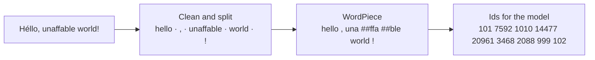

# Mini BERT

[](https://github.com/omdkpatel810-ops/mini-bert/actions/workflows/tests.yml)


[](LICENSE)

BERT, the language model behind Google Search's 2019 upgrade, built from scratch to learn how it works inside. Each part gets checked against Google's own code and weights.

> **Status: milestone 1 of 5 is done.** This is BERT's tokenizer, which turns text into the numbers the model reads, plus a trainer for its vocabulary. The Transformer itself comes next ([roadmap](#roadmap)).

**At a glance**

- **Exactly Google's tokenizer.** It gives the same tokens as Google's original BERT code on all 511,834 tokens of WikiText-103's test and validation text, and on over 10,000 random Unicode strings in every test run. It is 2.5x faster than Google's Python.
- **Found three ways Hugging Face's Rust tokenizer differs from Google's code,** including a typo in one of its Chinese-character ranges ([details](#where-hugging-face-differs-from-google)).
- **Trained our own 30,522-token vocabulary** on 105 million words of Wikipedia in 2 min 40 s. It splits held-out text into 1.081 tokens per word, the same as Hugging Face's trainer and fewer than Google's vocabulary (1.094).
- 77 tests with 100% line coverage, mostly property-based (Hypothesis), run on Python 3.10 and 3.13.

## How BERT reads text



```text
$ minibert tokenize "Héllo, unaffable world!"
[CLS]     101
hello    7592
,        1010
una     14477
##ffa   20961
##ble    3468
world    2088
!         999
[SEP]     102
9 tokens
```

1. **Clean and split into words.** Drop control characters, put spaces around Chinese characters, lowercase, strip accents (*Héllo* → *hello*) and split off punctuation.
2. **WordPiece.** Each word becomes the longest pieces found in the 30,522-token vocabulary, left to right. *unaffable* isn't in the vocabulary, but *una*, *##ffa* and *##ble* are. The *##* marks a piece that continues a word. A word that can't be built from known pieces becomes `[UNK]`.
3. **Ids.** `[CLS]` starts every input, which BERT later uses to classify the whole text. `[SEP]` ends each sentence. Each token becomes its line number in the vocabulary.

Pairs of texts (a question and a passage, say) get a sentence A/B marker for every token. When a pair is too long, tokens come off the longer side first, as in Google's code. `[MASK]` typed in the text stays a special token, so fill-in-the-blank works in milestone 2.

## Quick start

Requires Python 3.10 or newer. The tokenizer uses only the standard library.

```bash
git clone https://github.com/omdkpatel810-ops/mini-bert.git
cd mini-bert
python3 -m venv .venv
source .venv/bin/activate        # Windows: .venv\Scripts\activate
pip install -e ".[dev,data]"

minibert tokenize "Where is Winnipeg?" --pair "Winnipeg is in Manitoba."
```

```python
from minibert.tokenizer import Tokenizer

# Google's vocabulary ships with the package.
tokenizer = Tokenizer.bert_base_uncased()
batch = tokenizer.encode_batch(["Hi", "Hello there, world"], max_length=128)

# Padded to the length of the longest input; 0 in the mask means padding.
print(batch[0].ids)  # [101, 7632, 102, 0, 0, 0]
print(batch[0].attention_mask)  # [1, 1, 1, 0, 0, 0]
```

## Training a vocabulary

Google never published how it built BERT's vocabulary. This uses the method Hugging Face's WordPiece trainer uses:

1. **Count words.** Split the text exactly as the tokenizer will, and count each word, using every CPU core.
2. **Start with characters.** Every character gets two tokens, *a* to start a word and *##a* to continue one. Only the 1,000 most common characters get tokens; rarer ones will be `[UNK]`.
3. **Merge pairs.** Write each word as characters (*h ##u ##g*). Then repeatedly glue the most frequent neighbouring pair into a new token (*##u* + *##g* → *##ug*) until the vocabulary is full.

Recounting every pair after each of the 28,517 merges would take hours. Instead, each merge updates the counts only for the words it touches, and a heap finds the next most frequent pair.

```bash
python scripts/get_wikitext.py                    # WikiText-103 into data/
minibert train-tokenizer data/wikitext-103/train.txt --out runs/wikitext-vocab.txt
```

```text
Counted 105,076,292 words (519,571 different) in 35.1 s.
Learned 30,522 tokens (28,517 merges) in 124.6 s. Saved runs/wikitext-vocab.txt.
  Left out 3,437 words with rare characters outside the 1,000-character alphabet; they will become [UNK].
```

On WikiText-103's held-out test text (249,712 words), from `scripts/compare_vocabs.py`:

| Vocabulary | Trained on | Time | Tokens per word | Words split | `[UNK]` |
| --- | --- | ---: | ---: | ---: | ---: |
| Ours | WikiText-103 | 160 s (Python) | **1.081** | 5.6% | 0.009% |
| Hugging Face's trainer | WikiText-103 | 85 s (Rust) | **1.081** | 5.6% | 0.008% |
| Google's bert-base-uncased | Wikipedia and books | — | 1.094 | 5.7% | 0.012% |

Our trainer and Hugging Face's share 29,988 of their 30,522 tokens; the rest differ on how ties are broken. A vocabulary trained on the text it will read splits fewer words, which is why both beat Google's general-purpose one here.

## Checking it's right

Google's original `tokenization.py` sits in `tests/reference/`. Its only change is replacing two TensorFlow imports, so it runs without TensorFlow. It's the referee:

- `scripts/compare_tokenizers.py` runs Google's code, ours and Hugging Face's over WikiText-103's test and validation text. All 5,352 lines come out identical.

  | Tokenizer | Time |
  | --- | ---: |
  | Google's original (Python) | 2.3 s |
  | Ours (Python) | 0.9 s |
  | Hugging Face (Rust) | 1.1 s |

- Property tests feed thousands of random Unicode strings (emoji, accents, control characters, every script) to ours and to Google's, cased and uncased, and require identical output.

Ours is faster than Google's because each rule is one regular expression over a character class built once from Unicode's tables. Google's code checks every character's category in a Python loop. Plain ASCII text, the common case, takes an even faster path.

### Where Hugging Face differs from Google

The property tests found three differences, which ours does not share:

| Input | Google and ours | Hugging Face | Why |
| --- | --- | --- | --- |
| `a𫠠b` (U+2B820) | `a [UNK] b` | `[UNK]` | A typo in one Chinese-character range: Hugging Face starts it at U+2B920, Google at U+2B820, so 256 characters aren't split off |
| `caf` + private-use character + `e` | `[UNK]` | `cafe` | Hugging Face deletes private-use and unassigned characters; Google only deletes control characters |
| `𞥄` (an Adlam mark from 2016) | nothing | `[UNK]` | Hugging Face's Unicode tables predate it, so it isn't known to be an accent |

None of these matter for English text, but they're why "matches Hugging Face" isn't the same as "matches BERT".

## Tests

```bash
python -m pytest --cov     # 77 tests, 100% coverage; fails under 95%
ruff check . && ruff format --check .
```

GitHub Actions runs the suite on Python 3.10 and 3.13 on every push.

## Roadmap

- [x] **1. Tokenizer:** Google's WordPiece tokenizer, exactly, and a vocabulary trainer
- [ ] **2. Model:** the Transformer encoder in PyTorch; load Google's BERT weights and match Hugging Face's outputs
- [ ] **3. Pre-training:** teach a small BERT English by guessing hidden words
- [ ] **4. Fine-tuning:** sentiment analysis, compared with Google's BERT of the same size
- [ ] **5. Ship it**

## Credits

Google's BERT vocabulary (`minibert/data/`) and original tokenizer (`tests/reference/`) are Apache-2.0, from [google-research/bert](https://github.com/google-research/bert). WikiText-103 is by Salesforce Research, CC BY-SA 3.0.

## License

[MIT](LICENSE) © 2026 Om Patel
